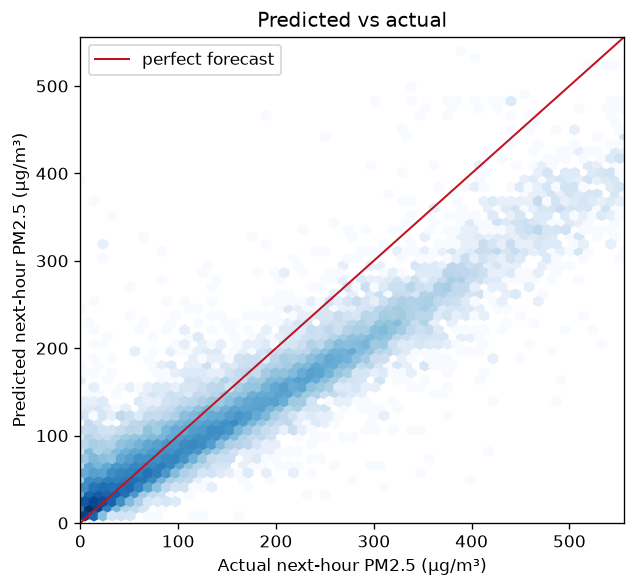
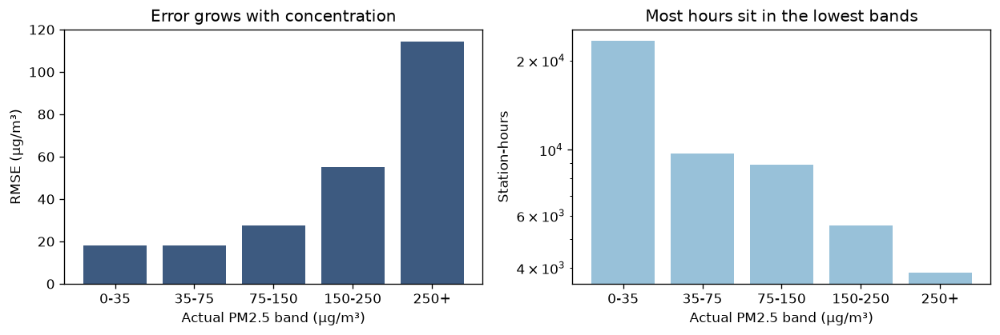
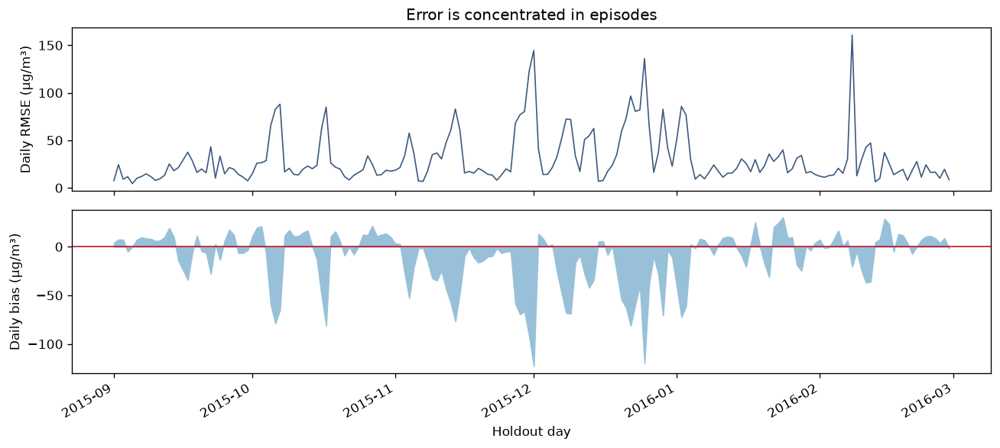

# BASELINE TEST — pm10_anchor

Next-hour PM2.5 as a fitted line through PM10 at the observation hour. The bar every rung is measured against.


## Scores

Season-matched holdout blocks, each trained only on the data preceding it
([ADR-0002](../../docs/adr/0002-season-matched-validation.md)). Persistence is re-scored on the
same holdout rows, so the comparison is like-for-like.

| Fold | Train rows | Holdout rows | RMSE | MAE | Persistence RMSE | vs persistence | Fit (s) |
|---|---|---|---|---|---|---|---|
| 2015-09_to_2016-03 | 257,927 | 51,349 | 40.664 | 24.650 | 40.664 | +0.00% | 0.0 |
| 2014-09_to_2015-03 | 155,190 | 50,799 | 43.425 | 25.504 | 43.425 | +0.00% | 0.0 |

This is the **baseline test**. Every other rung in `ML_Algorithms/` is measured against the number in the table above; it is not measured against anything itself.

## Submission

`submission.csv` — 51,063 rows, produced by refitting on every labelled
training station-hour and predicting the hidden test window. It passed `submission.validate`:
row count, id set, no blanks, no negative concentrations.

## Reproduce

```bash
.venv/bin/python -m src.cache                      # build data/train.parquet if absent
.venv/bin/python -m src.experiments 01_baseline_pm10_anchor
```

Total run time: 0.7s.

## Figures

### Predicted vs actual

Predicted against actual next-hour PM2.5 on the primary holdout.



### Error by level

RMSE within each air-quality band, and how many hours sit in each.



### Residuals over time

Daily RMSE and daily bias across the holdout block.


