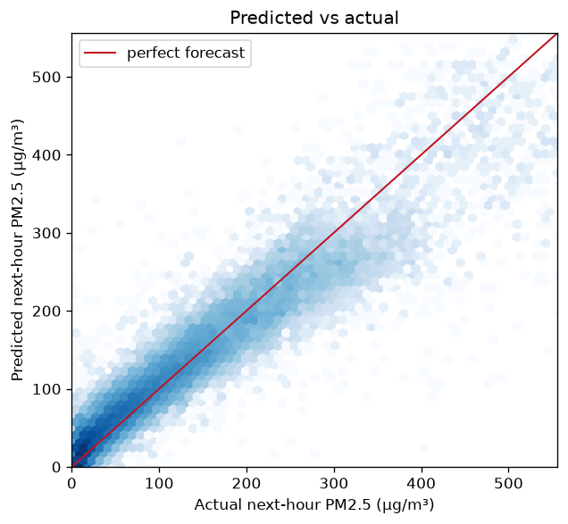
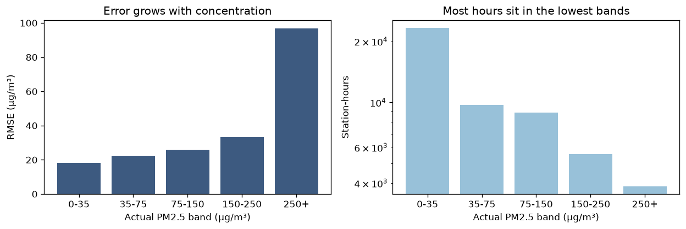
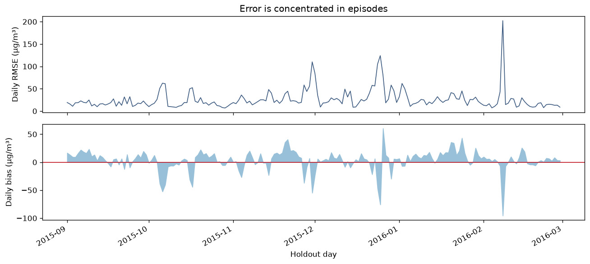
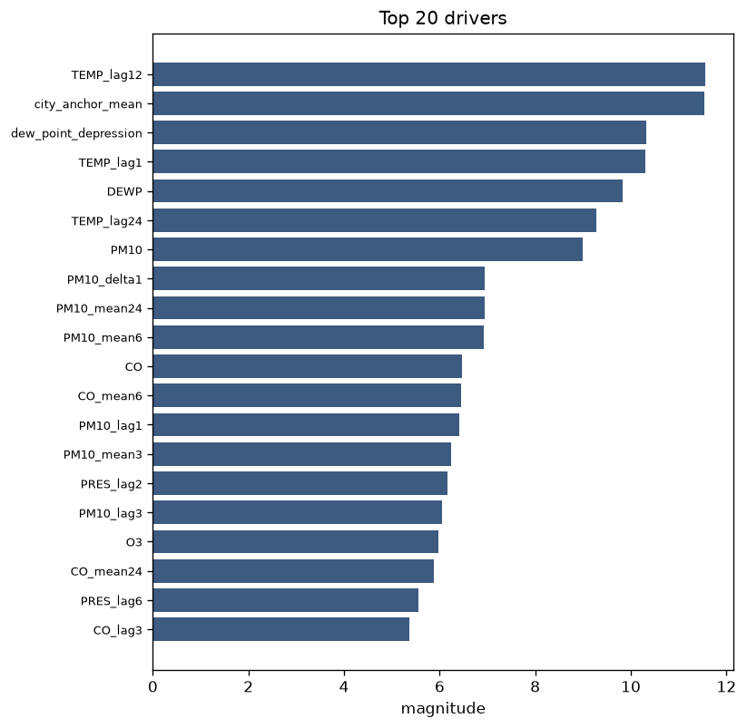

# TEST 02 — ridge

Regularised linear regression on the median-filled frame. How much of the signal is linear?


## Scores

Season-matched holdout blocks, each trained only on the data preceding it
([ADR-0002](../../docs/adr/0002-season-matched-validation.md)). Persistence is re-scored on the
same holdout rows, so the comparison is like-for-like.

| Fold | Train rows | Holdout rows | RMSE | MAE | Persistence RMSE | vs persistence | Fit (s) |
|---|---|---|---|---|---|---|---|
| 2015-09_to_2016-03 | 257,927 | 51,349 | 34.396 | 20.261 | 40.664 | +15.41% | 4.7 |
| 2014-09_to_2015-03 | 155,190 | 50,799 | 34.367 | 22.065 | 43.425 | +20.86% | 0.5 |

**Beats the baseline** by 15.41% RMSE on the primary fold (34.396 against persistence's 40.664).

## Submission

`submission.csv` — 51,063 rows, produced by refitting on every labelled
training station-hour and predicting the hidden test window. It passed `submission.validate`:
row count, id set, no blanks, no negative concentrations.

## Reproduce

```bash
.venv/bin/python -m src.cache                      # build data/train.parquet if absent
.venv/bin/python -m src.experiments 02_ridge
```

Total run time: 7.2s.

## Figures

### Predicted vs actual

Predicted against actual next-hour PM2.5 on the primary holdout.



### Error by level

RMSE within each air-quality band, and how many hours sit in each.



### Residuals over time

Daily RMSE and daily bias across the holdout block.



### Top drivers

The features the model leaned on hardest.


